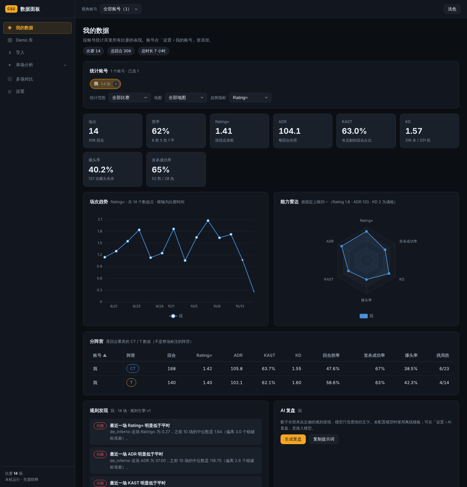

# CS2 数据面板

一个在自己电脑上运行的 CS2 录像分析工具。把比赛 demo 丢进去，它会解析出每个人每一回合做了什么，然后帮你回答这些问题：

- 我最近的状态是在变好还是变差？
- 我打 CT 和打 T 哪边更强？哪张图是我的短板？
- 我的首杀对枪、残局、经济局表现如何？
- 这一场里我有哪些值得回看的高光回合？

所有数据都留在本机，不需要联网，也不需要注册任何账号。



更多界面见 [shots/](shots/) 目录。截图里的比赛和玩家都是程序生成的合成数据，不对应任何真实账号。

## 能做什么

**我的数据。** 选定自己的 Steam 账号后，首页会汇总你在库里所有比赛的表现：胜率、Rating、ADR、KAST、爆头率、首杀成功率，以及场次趋势和能力雷达。可以只看最近 5 / 10 / 20 场，也可以只看某张地图；选了「最近 N 场」时，每个数字旁边会显示和再往前 N 场相比是升是降。

**分阵营、分地图、分武器。** CT 和 T 的数据是逐回合重新计算的，不是简单地按整场的阵营标注来分，所以半场换边不会让数字串到另一边。地图可以再细分到「某张图的 CT 方」。武器表会告诉你每把枪的击杀、爆头率、命中率和平均几发子弹换一个击杀。经济表按你这边的买法（手枪局、经济局、强起、长枪局）统计回合胜率。

**规则发现。** 程序会用一组固定的规则去读你的数据，列出值得注意的地方，比如「最近一场明显低于平时」「Rating 连续 4 场下滑」「CT 方打得凶但留不住」「最拿手 / 最吃力的地图」。样本太少的维度（例如某张图只打了两场）会明确标成样本不足，不会硬下结论。

**AI 复盘。** 可以把上面的规则发现交给大模型写成一段文字复盘。数字全部由程序算好，模型只负责组织语言，不会自己编数字。不想接模型也可以：默认用离线模板生成，或者一键复制提示词，粘贴到你常用的聊天工具里。

**高光时刻。** 自动识别 ACE、四杀、残局、短时间连杀，以及盲狙、穿烟、穿墙击杀，按评分排序。点一下就跳到回放的那个时刻。

**单场分析。** 每场比赛有队伍比分和逐回合的胜负条、经济曲线、比分走势、记分板（含 CT / T 分阵营数据）、击杀/死亡/射击热力图（可以只看某个人），以及按 tick 重建的走位回放和击杀记录。

**Demo 管理。** 同一个文件重复导入会被自动识别。解析完成后，demo 本体可以删掉以节省空间，统计数据完全不受影响；想保留回放的比赛可以单独标记。数据库可以一键导出，换电脑时带走这一个文件就行。

## 开始使用

### 便携包（Windows）

双击 `CS2数据面板.exe`，浏览器会自动打开面板。程序会缩到右下角托盘，右键托盘图标可以退出。便携包自带 Python 和地图资产，不需要安装任何东西。

第一次使用的步骤：

1. 打开「导入」，把 `.dem` 文件拖进去，或者点「扫描本机录像」，程序会自动找到 Steam 库里的 CS2 录像。
2. 解析完成后，去「设置 › 我的账号」，从名册里选出你自己（出场次数最多的那个通常就是你）。
3. 回到「我的数据」，就能看到汇总了。

只支持 CS2（Source 2）的 demo，CS:GO 时代的老录像会被直接拒绝并给出提示。

### 从源码运行

需要 Python 3.11 或更新版本。

```
pip install -r requirements.txt
python -m app.main
```

默认地址是 `http://127.0.0.1:8765`，端口被占用时会自动往后找。想要雷达底图的话，按 `fetch_mapdata.ps1` 的方式把 awpy-data 的地图资产放进 `mapdata/` 目录；没有底图时热力图和回放仍然可用，只是背景是空白的。

几个可选的环境变量：`CS2_PANEL_DATA_DIR` 指定数据目录，`CS2_PANEL_PORT` 指定端口，`CS2_PANEL_NO_BROWSER=1` 不自动打开浏览器，`CS2_PANEL_SCAN_DIRS` 追加扫描目录（多个目录用系统路径分隔符隔开）。

## 数据存在哪里

所有东西都在 `数据/` 目录里：

- `panel.db` 是数据库，里面有每场比赛解析出的完整原始数据和所有统计。**这是真正需要保存的东西。**
- `demos/` 是从网页上传的 demo 副本。直接从 Steam 目录解析的录像不会被复制，程序也永远不会删除 Steam 目录里的文件。
- `replay_cache/` 是看过的回合的走位轨迹缓存，删掉只会让下次打开回放慢一点。
- `backups/` 是数据库升级前自动做的备份，以及你手动点「立即备份」生成的文件。

### demo 本体可以删吗？

可以。解析一次之后，所有统计、趋势、高光、AI 复盘都只读数据库，不再需要 demo。删掉 demo 后唯一受影响的是：没看过的回合不能再生成回放，也不能用新版解析器重新解析。看过的回合有缓存，仍然可以播放。

设置页可以设一个回收期限（默认 30 天）。超过期限、又没有标记「保留回放」的 demo 会显示为「可回收」，但只有你点了按钮才会删除，程序不会自动删任何东西。

### 软件升级会不会让旧数据失效？

不会。每场比赛解析时，完整的原始数据都会压缩存进数据库，并记下当时用的解析器版本。以后统计口径改进时，程序会在后台用这些存档重新计算，不需要原来的 demo。数据库结构升级前会自动备份一份。

## 关于数字的口径

- **Rating≈** 是社区流传的 Rating 2.0 近似公式，用来横向比较，不是 HLTV 的官方数值。
- **胜负按队伍算。** 比分显示的是两支队伍的得分；页面上另外标注的「CT 方赢几回合、T 方赢几回合」是按阵营统计的，两者不是一回事。
- **CT / T 是逐回合推断的。** 程序会根据每个回合里的击杀、伤害、购买和开火记录判断每个人在那一回合站哪边，再把十个人分成两队。刀局不计入统计。
- **ADR** 的每一次伤害按受害者当时的剩余血量封顶，和 awpy 的口径一致。
- **样本门槛。** 少于 3 场或少于 30 个回合的维度会标成「样本少」，规则发现也不会拿它们下结论。

## AI 复盘怎么配置

在「设置 › AI 复盘」里选择方式：

- **离线模板**：默认选项，完全不联网。
- **手动**：生成复盘时把提示词复制到剪贴板，你自己粘贴到任何聊天工具。
- **OpenAI 兼容接口**：适用于各种中转服务、DeepSeek，以及本地的 ollama（地址填 `http://127.0.0.1:11434/v1`）。
- **Claude**：需要先在运行环境里执行 `pip install anthropic`，再填入 API key。

API key 只保存在本机数据库里，界面上不会显示明文。每次生成的复盘都会存下来，并记录用的是哪个模型、哪个版本的规则引擎和提示词。

## 常见问题

**解析一场要多久？** 取决于 demo 大小和电脑性能，一般十几秒到一分钟。后台最多同时解析两个，其余排队。刷新页面不会打断解析。

**杀毒软件或 SmartScreen 报风险？** 便携包里的启动器没有做代码签名，选择「更多信息 › 仍要运行」即可。

**首页提示「有重复导入的比赛」？** 同一场比赛被导入了两次，会让汇总数字重复计算。去 Demo 库的状态筛选里选「重复导入」，删掉多余的那一场。

**为什么某场比赛显示「待重算」？** 程序升级后，旧比赛的统计会在后台按新口径重新计算，通常几秒就好。

## 开发

项目结构、数据表和版本号的规则写在 [docs/架构说明.md](docs/架构说明.md)，这一轮做了什么、接下来打算做什么写在 [docs/迭代路线.md](docs/迭代路线.md)。

跑测试：

```
pip install -r requirements-dev.txt
python -m pytest
```

测试不需要真实 demo：`app/devtools/synth.py` 能按 awpy 的数据格式生成「像真的」比赛，并附带标准答案，用来校验阵营推断、ADR、KAST、多杀和高光识别。浏览器冒烟测试需要 Playwright 和 Chromium，没装的话会自动跳过。

想不导入真实 demo 就看看界面长什么样，可以先造一个假数据库：

```
python tools/seed_demo_data.py 数据_预览
```

然后把环境变量 `CS2_PANEL_DATA_DIR` 设成 `数据_预览` 再启动。

前端没有构建步骤：`app/static/js/` 下的文件按顺序直接加载，改完刷新浏览器即可。便携包用 `build_dist.py` 在 Windows 上打包。
